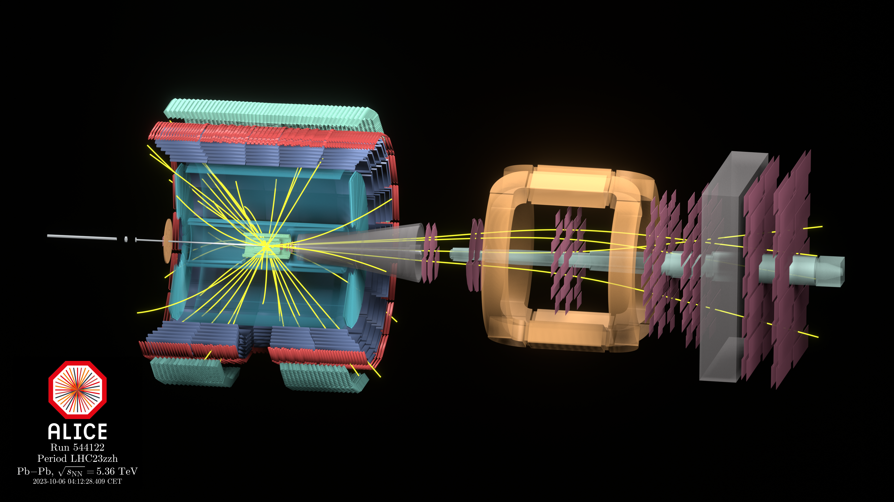

# ALICE event displays

A small toolkit made in a humble attempt at producing 3D event displays of the ALICE experiment from Run 3 AO2D data. Hope this helps creating nice displays for your presentations :)

Detector geometry is extracted from the aligned O2 geometry in CCDB, reconstructed tracks are propagated through the magnetic field with material corrections, and the resulting geometry and trajectories are rendered in Blender. A separate Matplotlib script adds the ALICE logo, run information, and the candidate timestamp



> **Scope:** This is a simplified **track-only** visualization, without digit, cluster, or calorimeter-hit rendering. It is intended for outreach and presentation displays, not detector-performance validation. The code and examples are provided **as is**

## Requirements

- **Tested platform:** AlmaLinux 9.8 (x86_64), Blender **3.3.21**
- **O2 environment:** CVMFS with O2/O2Physics and PyROOT; developed with `O2PDPSuite::MC-prod-2026-v13-1`. Recent O2 daily builds with the required APIs should also work, but have not been systematically tested
- **For rendering:** Blender with Python `numpy` available to its Python interpreter
- **For the overlay:** Python 3 with `numpy` and `matplotlib`
- **For data extraction:** access to ALICE CCDB and, for the example AO2D file, authorized Grid access via `alien.py`

The ROOT macros need the O2 libraries and are not standalone ROOT macros. The geometry and event export steps query CCDB, so network access is required

Run the commands below **from the repository root**. For example, enter an O2 environment before executing the ROOT macros:

```bash
/cvmfs/alice.cern.ch/bin/alienv enter O2PDPSuite::MC-prod-2026-v13-1
```

## Quick start: render the included example

The repository already contains geometry under `assets/geo/obj/` and five track candidates for run **544122** under `examples/events/`. No CCDB or AO2D input is required for this step, run this outside O2 environment to avoid dependency collisions

```bash
mkdir -p renders
blender -b --python render.py -- \
  --input-card cards/display-fast.json \
  --tracks-npz examples/events/candidate_0002_tracks.npz \
  --output renders/display.png
```

Use `cards/display-quality.json` for a 3840 × 2160 render with 1000 samples. `display-barrel.json` and `display-forward.json` provide alternate camera presets. Display cards inherit from `cards/display-fast.json` and command-line arguments override individual settings

To add the ALICE logo and run information, use ordinary Python with Matplotlib installed:

```bash
python3 postprocess_overlay.py \
  --overlay-card cards/overlay-default.json \
  --image renders/display.png \
  --tracks-npz examples/events/candidate_0002_tracks.npz \
  --output renders/display-with-info.png
```

The default overlay card contains the metadata for this example (`LHC23zzh`, Pb–Pb, 5.36 TeV, run 544122). The date and time are read from the candidate's `candidate_timestampMs` field. The logo is loaded from `assets/logo/ALICE-logo.png`. The compact layout is selected with `cards/overlay-compact.json`

## Full workflow: generate your own display

### 1. Export detector geometry

Load the O2 environment and export geometry for the desired run. Use a separate output directory to keep the bundled OBJ files unchanged:

```bash
mkdir -p work/geometry
root -l -b -q 'export_geometry.C++(544122,"work/geometry/display")'
```

`export_geometry.C` loads `GLO/Config/GeometryAligned` from CCDB using the run number and creates one `display_<GROUP>.obj` per detector group. The files contain coordinates in meters, transformed to Blender axes `(X, Y, Z) = (ALICE z, x, y) / 100`. Detector groups and tessellation settings are configurable through the macro arguments

To render only this newly extracted geometry, override the OBJ glob in the display card:

```bash
blender -b --python render.py -- \
  --input-card cards/display-fast.json \
  --inputs 'work/geometry/display_*.obj' \
  --output renders/geometry.png
```

### 2. Get an AO2D file

The example candidates were extracted from this 2023 Pb–Pb file on the ALICE Grid:

```text
/alice/data/2023/LHC23zzh/544122/apass4/0410/o2_ctf_run00544122_orbit0136011072_tf0000000001_epn311/001/AO2D.root
```

For an account with Grid access, copy it to the local `data/` directory:

```bash
mkdir -p data
alien.py cp alien:///alice/data/2023/LHC23zzh/544122/apass4/0410/o2_ctf_run00544122_orbit0136011072_tf0000000001_epn311/001/AO2D.root file:./data/AO2D.root
```

You can use any compatible Run 3 AO2D file instead; change the input path in the next step

### 3. Select candidates and export trajectories

Review `cards/selection.conf` and adjust the collision or BC mode, track multiplicity requirements, detector matching, and kinematic cuts for your event type. The supplied card is tuned for the bundled example and requires both barrel and forward tracks

```bash
root -l -b -q 'export_event.C++("data/AO2D.root","events","cards/selection.conf")'
```

`export_event.C` writes one `events/candidate_XXXX.root` file per selected candidate. It propagates tracks to the collision vertex (or the origin [0,0,0] for ambiguous tracks) for the kinematic cuts, then samples material-aware trajectories. Candidate metadata include the run number, global BC, and Unix timestamp in milliseconds

### 4. Convert ROOT trajectories to NPZ

With PyROOT and NumPy available:

```bash
python3 tree_to_npz.py 'events/candidate_*.root'
```

The converter writes `events/candidate_XXXX_tracks.npz`, containing the sampled 3D trajectories in Blender coordinates and the metadata required by the overlay

### 5. Render the candidate

Use the OBJ files exported in **step 1** and select any candidate produced in **step 4**:

```bash
mkdir -p renders
blender -b --python render.py -- \
  --input-card cards/display-quality.json \
  --inputs 'work/geometry/display_*.obj' \
  --tracks-npz events/candidate_0000_tracks.npz \
  --output renders/display.png \
  --save-blend renders/display.blend
```

**The JSON display cards configure geometry colors, transparency, solidification (additional thickness for thin sensitive elements), cutout, lighting, track styling, camera, resolution, and samples. Edit a card or supply CLI overrides to change individual settings**

### 6. Add the ALICE branding

Set `metadata` in `cards/overlay-default.json`, or override it on the command line:

```bash
python3 postprocess_overlay.py \
  --overlay-card cards/overlay-default.json \
  --image renders/display.png \
  --tracks-npz events/candidate_0000_tracks.npz \
  --run-number 544122 \
  --period LHC23zzh \
  --system 'Pb-Pb' \
  --energy '\sqrt{s_{\rm NN}} = 5.36~\mathrm{TeV}' \
  --output renders/display-with-info.png
```

The overlay supports Computer Modern fonts, Matplotlib MathText, font-size settings, transparency, placement in any corner, and timestamps from NPZ. To use a different time zone, set `metadata.time_zone` to a valid IANA zone such as `Europe/Zurich`. Metadata (run, period, system, energy) should reflect the actual input dataset -- check your inputs if you are using a different input file

## Repository layout

```text
export_geometry.C       Aligned CCDB geometry → OBJ
export_event.C          AO2D candidate selection → ROOT trajectories
tree_to_npz.py          ROOT trajectories → Blender NPZ
render.py               OBJ + NPZ → rendered PNG
postprocess_overlay.py  Rendered PNG + metadata → branded PNG
cards/                  Selection, display, and overlay configurations
assets/geo/obj/         Ready-to-use detector geometry
assets/logo/            ALICE logo
examples/events/        Five ROOT/NPZ candidate examples
examples/displays/      Example rendered images
```

## References and attribution

- [ALICE O2 repository](https://github.com/AliceO2Group/AliceO2) — detector geometry, tracking, propagator, and CCDB interfaces; see also [`GeometryManager.h`](https://github.com/AliceO2Group/AliceO2/blob/dev/Detectors/Base/include/DetectorsBase/GeometryManager.h)
- [ALICE O2Physics repository](https://github.com/AliceO2Group/O2Physics) — analysis data model and reconstruction examples
- [ALICE experiment logo, CERN Document Server, record 1696920](https://cds.cern.ch/record/1696920) — © CERN, for the benefit of the ALICE Collaboration. The ALICE logo is subject to CERN/ALICE usage conditions and is not covered by any license applied to this code
